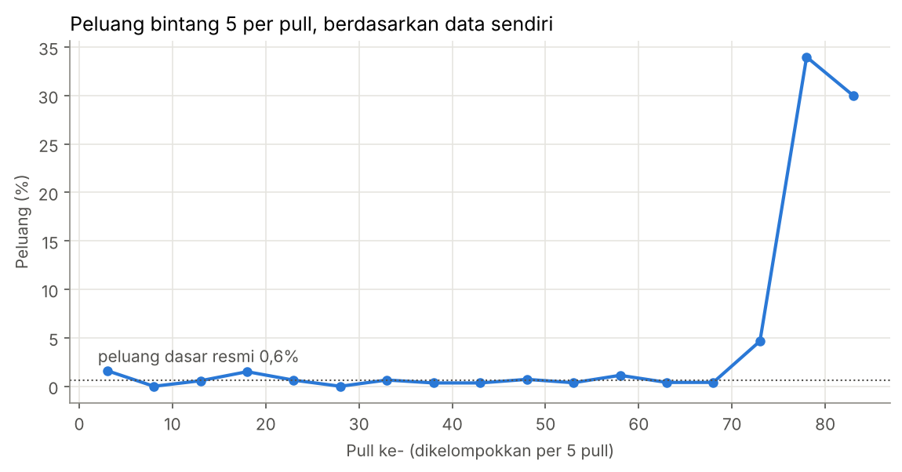
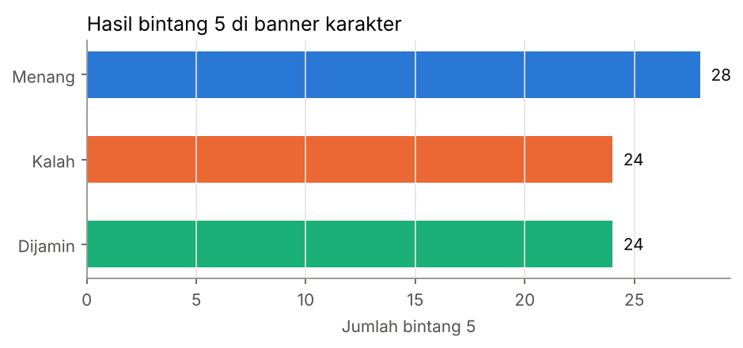
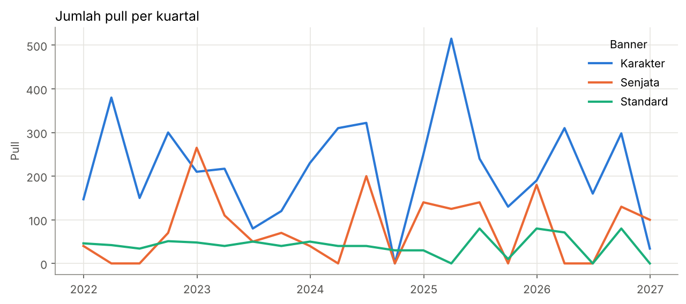

# Genshin Wish Analysis

Analisis 7.000+ data gacha Genshin Impact (2021–2026) dengan Python untuk menguji soft pity, win rate 50/50, dan nilai setara rupiah per bintang 5.

## Latar belakang

Genshin Impact memakai sistem *gacha*: setiap "pull" adalah undian berbayar (160 Primogem). Menurut informasi resmi, peluang dasar mendapat item bintang 5 di banner karakter adalah 0,6%, dengan jaminan bintang 5 paling lambat di pull ke-90. Komunitas pemain percaya ada **soft pity**, yaitu peluang yang naik drastis sekitar pull ke-74, tapi angka ini tidak dijelaskan secara rinci oleh developer.

Proyek ini memakai riwayat wish pribadi untuk menguji apakah pola tersebut benar-benar terlihat di data.

## Pertanyaan analisis

1. Berapa rata-rata pull yang dibutuhkan untuk mendapat bintang 5?
2. Apakah soft pity terlihat di data nyata?
3. Seberapa sering menang atau kalah 50/50?
4. Bagaimana pola pull dari waktu ke waktu?
5. Berapa nilai setara rupiah untuk satu bintang 5?

## Data

- **Sumber:** riwayat wish satu akun, diekspor dari [paimon.moe](https://paimon.moe) (data sekunder)
- **Periode:** Oktober 2021 – November 2026
- **Ukuran:** 7.115 pull (banner karakter 4.593, senjata 1.660, standard 862)
- **Kualitas:** tidak ada nilai kosong; pity yang dihitung ulang sudah divalidasi terhadap kolom pity bawaan paimon.moe

File data mentah tidak disertakan di repository ini karena berisi data akun pribadi.

## Temuan utama

**1. Soft pity terkonfirmasi.** Di pull 1–73, peluang bintang 5 hanya **0,66%**, sangat dekat dengan angka resmi 0,6%. Mulai pull ke-74, peluangnya melonjak menjadi **sekitar 23%** per pull.

**2. Mayoritas bintang 5 keluar di soft pity.** Rata-rata dibutuhkan **60 pull** per bintang 5 (median 76), dan **62%** bintang 5 keluar di pull ke-74 atau lebih.

**3. Win rate 50/50 sebesar 54%** (28 menang, 24 kalah), sesuai dengan mekanisme peluang sekitar 50%.

**4. Nilai setara rupiah.** Dengan harga top-up sekitar Rp32.257 per pull, satu bintang 5 di banner karakter bernilai setara **±Rp1,95 juta**.

## Implikasi

- Bagi pemain, menyimpan sumber daya sampai minimal **75–80 pull** jauh lebih realistis untuk mendapat bintang 5 daripada berharap pada peluang dasar.
- Dari sisi bisnis, desain soft pity membuat sebagian besar hadiah utama baru keluar setelah pemain berinvestasi cukup banyak. Ini mendorong pemain menabung atau melakukan top-up menjelang banner karakter favorit.

## Metode

- **Cleaning:** menggabungkan tiga sheet banner, menyeragamkan nama kolom, mengubah tipe tanggal, dan menghitung ulang pity per pull.
- **Hazard rate:** peluang bintang 5 di pull ke-n, dengan syarat belum mendapat bintang 5 sebelumnya.
- **Klasifikasi 50/50:** bintang 5 dianggap "kalah" jika karakter standard; daftar standard memperhitungkan tanggal masuk karakter (Tighnari v3.1, Dehya v3.6, Yumemizuki Mizuki v5.5).

## Tools

Python (pandas, NumPy, Matplotlib), Google Colab

## Keterbatasan

- Data hanya dari satu akun, sehingga hasilnya belum tentu mewakili seluruh pemain.
- Status 50/50 disimpulkan dari daftar karakter standard. Mekanisme *Capturing Radiance* (sejak v5.0) tidak terlihat langsung di data.
- Nilai rupiah adalah estimasi berdasarkan harga top-up, bukan pengeluaran sebenarnya.

## Pengembangan selanjutnya

- Membandingkan dengan dataset komunitas yang lebih besar
- Uji statistik (binomial test) untuk win rate 50/50
- Analisis banner senjata (Epitomized Path)

## File

| File | Isi |
|---|---|
| `analisis_wish_genshin.ipynb` | Notebook analisis lengkap |
| `*.png` | Grafik hasil analisis |

---
*Dibuat oleh Danish Ziaurrahman Muhammad*
