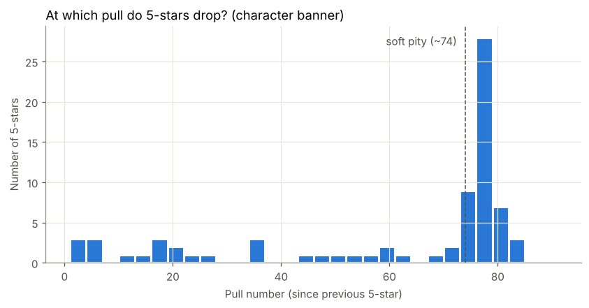

# Genshin Wish Analysis

Analysis of 7,000+ Genshin Impact gacha records (2021–2026) with Python to test soft pity, the 50/50 win rate, and the rupiah-equivalent value of a 5-star.

## Background

Genshin Impact uses a *gacha* system: each "pull" is a paid random draw (160 Primogems). According to official information, the base rate for a 5-star item on the character banner is 0.6%, with a guaranteed 5-star by pull 90. Players widely believe in **soft pity**, a sharp rise in the odds around pull 74, but the developer does not publish the exact numbers.

This project uses my personal wish history to test whether that pattern actually shows up in real data.

## Questions

1. How many pulls does it take on average to get a 5-star?
2. Is soft pity visible in real data?
3. How often is the 50/50 won or lost?
4. How has pulling behaviour changed over time?
5. What is the rupiah-equivalent value of one 5-star?

## Data

- **Source:** wish history from one account, exported from [paimon.moe](https://paimon.moe) (secondary data)
- **Period:** October 2021 – November 2026
- **Size:** 7,115 pulls (character banner 4,593, weapon 1,660, standard 862)
- **Quality:** no missing values; recalculated pity counts were validated against paimon.moe's own pity column

The raw data file is not included in this repository because it contains personal account data.

## Key findings

**1. Soft pity is confirmed.** For pulls 1–73, the 5-star probability is only **0.66%**, very close to the official 0.6%. From pull 74 onward, it jumps to **about 23%** per pull.

**2. Most 5-stars drop during soft pity.** It took **60 pulls** per 5-star on average (median 76), and **62%** of 5-stars dropped at pull 74 or later.

**3. The 50/50 win rate is 54%** (28 won, 24 lost), consistent with a roughly 50% mechanic.

**4. Rupiah-equivalent value.** At about Rp32,257 per pull (based on top-up prices), one character-banner 5-star is worth roughly **Rp1.95 million**.

## Implications

- For players, saving at least **75–80 pulls** is a far more realistic plan for getting a 5-star than relying on the base rate.
- From a business perspective, the soft-pity design means most premium rewards only appear after significant player investment. This encourages players to save resources or top up ahead of the banners they want.

## Method

- **Cleaning:** combined three banner sheets, standardised column names, converted date types, and recalculated pity for every pull.
- **Hazard rate:** the probability of a 5-star at pull n, given that no 5-star has appeared before it.
- **50/50 classification:** a 5-star counts as "lost" if it is a standard character; the standard list accounts for when each character joined the pool (Tighnari v3.1, Dehya v3.6, Yumemizuki Mizuki v5.5).

## Tools

Python (pandas, NumPy, Matplotlib), Google Colab

## Limitations

- Data comes from a single account, so results may not represent all players.
- 50/50 status is inferred from the standard character list. The *Capturing Radiance* mechanic (since v5.0) is not directly visible in the data.
- Rupiah values are estimates based on top-up prices, not actual spending.

## Next steps

- Compare with a larger community dataset
- Statistical test (binomial test) for the 50/50 win rate
- Analyse the weapon banner (Epitomized Path)

## Files

| File | Contents |
|---|---|
| `analisis_wish_genshin.ipynb` | Full analysis notebook |
| `*.png` | Analysis charts |

---
*Created by Danish Ziaurrahman Muhammad*
